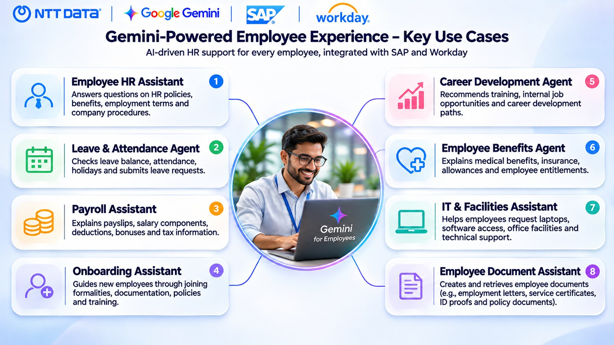
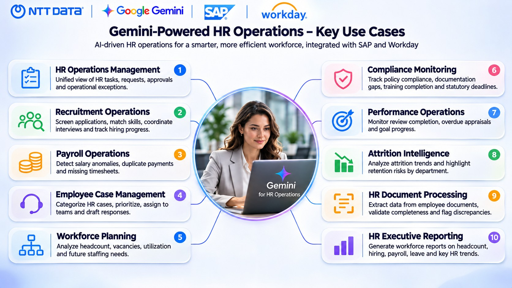
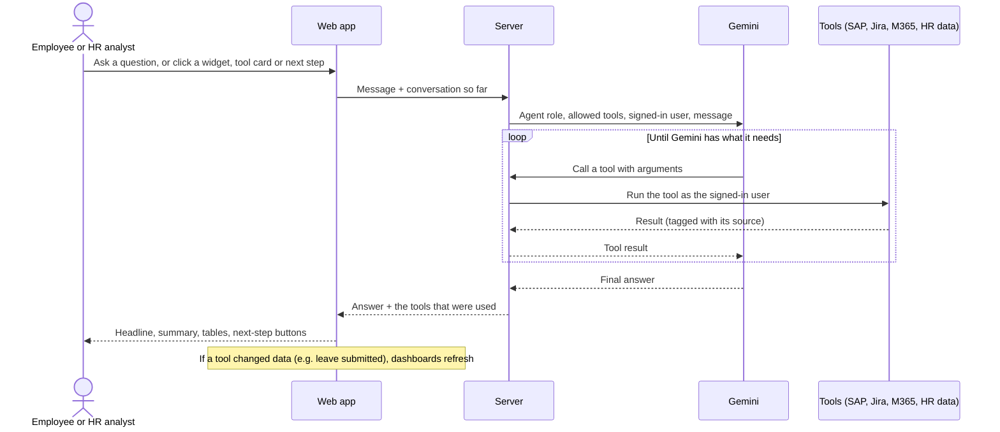
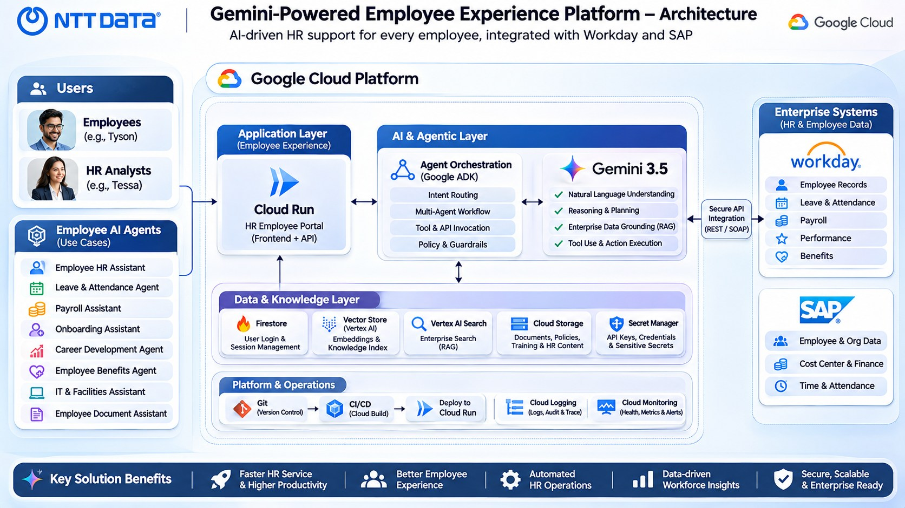

# NTT DATA HRMS: Gemini agents for HR

Eighteen Gemini agents on top of the HR system of record (SAP SuccessFactors), with live dashboards for two people:

- **Tyson, an employee**, who asks questions and gets things done without raising an HR ticket.
- **Tessa, an HR analyst**, who runs day-to-day HR operations and spots exceptions before they become problems.

Every answer comes from a real lookup in HR systems, not from the model's memory, and shows which systems it used.

---

## Use case scenarios

### Employee self-service (Tyson, 8 agents)

Tyson opens his home page and sees his leave balance, latest pay, attendance, upcoming holidays and open tasks. He then picks an agent and asks in plain language.

| Agent | What Tyson can do |
|---|---|
| Employee HR Assistant | Ask about policies, his profile and benefits |
| Leave & Attendance | Check balances, review attendance, **apply for leave** |
| Payroll Assistant | Understand a payslip, compare months, see deductions and tax |
| Onboarding Assistant | See what is still pending and get help finishing it |
| Career Development | Find matching internal roles and a learning plan |
| Employee Benefits | Understand benefits, allowances and claims |
| IT & Facilities | Request a laptop, software, badge or parking permit; **raised in Jira with live status** |
| Employee Document Assistant | Generate employment, salary, experience and visa letters |

Example: *"Apply annual leave from 22 to 24 December"* → the agent checks the balance, submits the request, and the leave tile and notifications on the home page update straight away.

### HR operations (Tessa, 10 agents)

Tessa's home page shows workforce, hiring, approvals, reviews, payroll and compliance signals from SAP SuccessFactors, filterable by division and by period (1, 3, 5, 10 years, all time or a custom range).

| Agent | What Tessa can do |
|---|---|
| HR Operations Copilot | See what needs attention today: approvals, workflows, overdue reviews |
| Recruitment Operations | Review the pipeline, screen applicants, schedule interviews |
| Payroll Operations | Find duplicates, large changes and outliers before pay day |
| Employee Case Management | Triage new cases and draft replies |
| Workforce Planning | Headcount, vacancies, hiring trend, country and department mix |
| Compliance Monitoring | Expiring documents, missing data, training completion |
| Performance Operations | Review completion and overdue reviews by division |
| Attrition Intelligence | High-risk employees, regrettable losses, hotspot divisions |
| HR Document Processing | Browse OneDrive and have Gemini extract the key details of a document |
| HR Executive Reporting | One-click executive report as PDF, PowerPoint or an Outlook draft; send highlights to Teams |

Example: *"Which divisions have the highest attrition risk?"* → the agent reads performance and risk-of-loss data from SAP, ranks the divisions and suggests next steps as one-click buttons.

---

## How an agent works

Each agent is a Gemini model with a fixed role and a short list of tools it is allowed to call. The tools do the real work against SAP SuccessFactors, Jira and Microsoft 365.

1. **Sign-in sets the role.** Employees and HR analysts see different agents and different data. HR can also sign in with Microsoft 365.
2. **The agent only uses its own tools.** Each agent can call only the tools listed for it, so the Leave agent cannot read payroll, and an employee agent cannot read other people's records.
3. **Gemini decides which tools to call**, reads the results, and can call several in a row (for example: leave balance, then submit the request).
4. **Answers are grounded.** Every figure comes from a tool result, and each reply shows which tools and systems were used (SAP, Jira, OneDrive).
5. **Replies follow one house style:** a headline, a highlighted summary, tables for records, short pointers, and **Next steps** that run as buttons.
6. **Actions are real.** Leave requests, IT and facilities requests (created as Jira issues), interview scheduling, case updates and letters are written back, and the dashboards update without a page reload.
7. **Dashboards stay live.** They refresh every minute, when you return to the tab, and after any agent action. Filters apply to every tile and chart.

### Where the data comes from

| System | Used for |
|---|---|
| **SAP SuccessFactors** | Workforce, positions, requisitions and applications, review forms, pay components, work permits, workflows, time-off approvals |
| **Jira** | IT and facilities requests and their live status |
| **Microsoft 365** | Sign-in for HR, OneDrive documents, Outlook draft of the executive report, Teams notifications |
| **Built-in HR data** | Employee-level records the SAP sandbox does not provide (leave, payslips, benefits, onboarding, cases) |

---

## Architecture

| Layer | What it does |
|---|---|
| Web app | Landing page, sign-in, dashboards, the agent picker, overview and docked chat |
| Server | Verifies the user, keeps the agent definitions, runs the Gemini tool-calling loop, applies caching and throttling to SAP |
| Gemini | Understands the request, chooses tools, writes the answer |
| Connected systems | SAP SuccessFactors, Jira, Microsoft 365 |

---

## Deployment

See [DEPLOY-CLOUD-RUN.md](DEPLOY-CLOUD-RUN.md) for deploying to Google Cloud Run with keys in Secret Manager.
